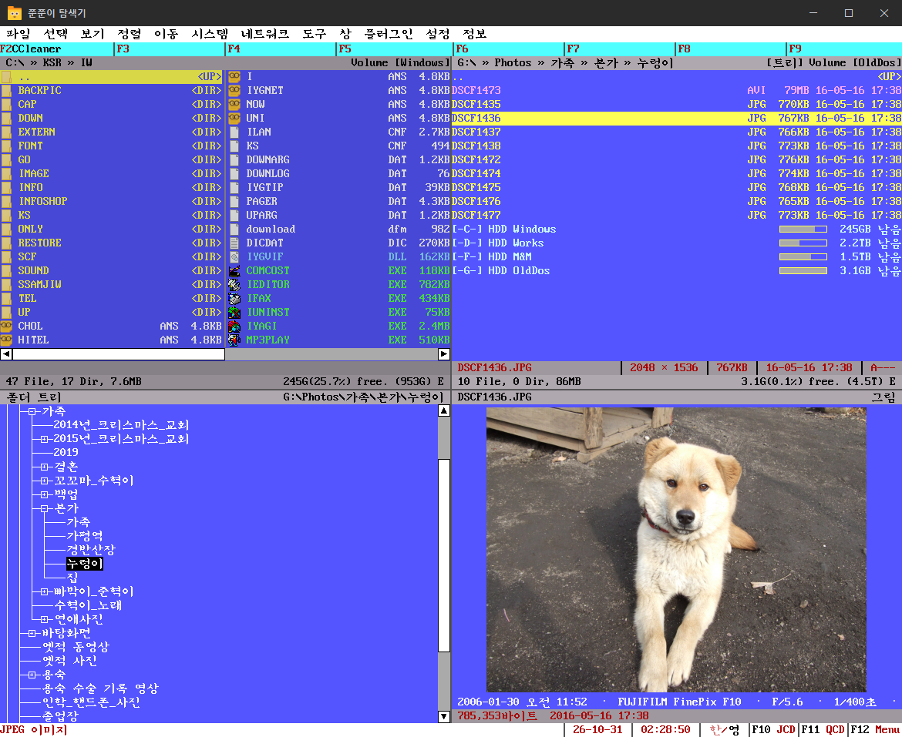

# JJ-Explorer (쭌쭌이 탐색기)

A file manager for Windows that brings back the look and feel of Mdir, the classic DOS file manager. Text-mode screen, bitmap Korean fonts and keyboard-first control, with the Windows features you expect: Recycle Bin, clipboard, shell context menus and long file names.

**[Download the latest version](https://github.com/hanulso78/jj-explorer-release/releases/latest)**

This repository only hosts the release files. Each release contains a zip file with the program and its manual.

The program and its manual are available in Korean and English. Choose the language in **Settings → Program Settings → Others → Language**; it switches at once without restarting.

## Features

**Panels and navigation**

- DOS text-mode screen with bitmap Korean and English fonts, with adjustable zoom
- Keyboard-first control: arrow keys to move, Space to select, function keys for commands. The mouse works too
- Up to four panels side by side, in eight split layouts
- Folder tree (JCD), favorite folders (QCD) with Shift+F1 to F12 hot keys, and back/forward history for each panel
- Filters, seven sort orders with optional natural sort, and a flat view of all files in subfolders
- FTP and SFTP folders open in a panel like local folders

**File operations**

- Copy, move, rename, delete to the Recycle Bin, and undo for these operations
- Bulk rename with find and replace, regular expressions, numbering, photo dates and clean-up rules, with a preview before renaming
- Three sets of function keys (F2 to F9, plus Alt and Ctrl) for your own programs or built-in commands
- Run a program by file extension, and a command line with name completion and history

**Archives**

- Open zip, 7z and other archives like folders. Add, delete and rename files inside 7z, zip, tar and wim archives without extracting
- Create archives with split volumes, passwords and self-extracting files

**Tools**

- File search by name, content, size, date and attributes, including inside archives, with a fast mode that reads the NTFS file table
- Duplicate file finder, empty folder clean-up, folder and file comparison
- Text encoding and line ending conversion, find and replace across many files
- Folder size treemap, checksums (CRC32, MD5, SHA-1, SHA-256), file split and join, and a check for programs that lock a file
- Image preview, with plugins for old DOS picture formats such as PCX
- Run DOS programs and games with DOSBox Staging or DOSBox-X

## Requirements

- Windows 10 (version 1809 or later) or Windows 11, 64-bit

## Install

1. Download `jj-explorer-<version>.zip` from the latest release.
2. Unzip it to any folder you can write to, for example `Documents\JJ-Explorer`. Avoid `Program Files`, because the program saves its settings in its own folder.
3. Run `jj-explorer.exe`. No installation is needed.

Press F1 in the program to open the manual.

## Update

Open **정보 (Info) → 업데이트 확인 (Check for updates)**. If a new version is available, click **지금 업데이트 (Update now)**. The program downloads it, checks its signature and restarts. Your settings, color files and plugin settings are kept.

You can also download the new zip and unzip it over the old folder.

## Uninstall

Close the program and delete its folder. All settings are stored in that folder (`jj-explorer.json`). If you saved FTP passwords, they are in Windows Credential Manager under names starting with `jj-explorer:`; delete them there if you want to remove them.

## Privacy

JJ-Explorer does not collect or send any usage data. It connects to the internet only when you click Check for updates (and then only to this GitHub repository), or when you connect to an FTP or SFTP server yourself.

## License

JJ-Explorer uses Qt (LGPL), 7-Zip (LGPL), libcurl, DOSBox Staging and DOSBox-X (GPL), and the DOSMyungjo font (MIT).

## Support

JJ-Explorer is free to use. If it is useful to you, you can support its development:

- **GitHub Sponsors** (card, monthly or one time): https://github.com/sponsors/hanulso78
- **Bank transfer in Korea**: KakaoBank `3333346492333` (민인학)

## Contact

Questions and feedback: https://groups.google.com/g/jj-explorer2
