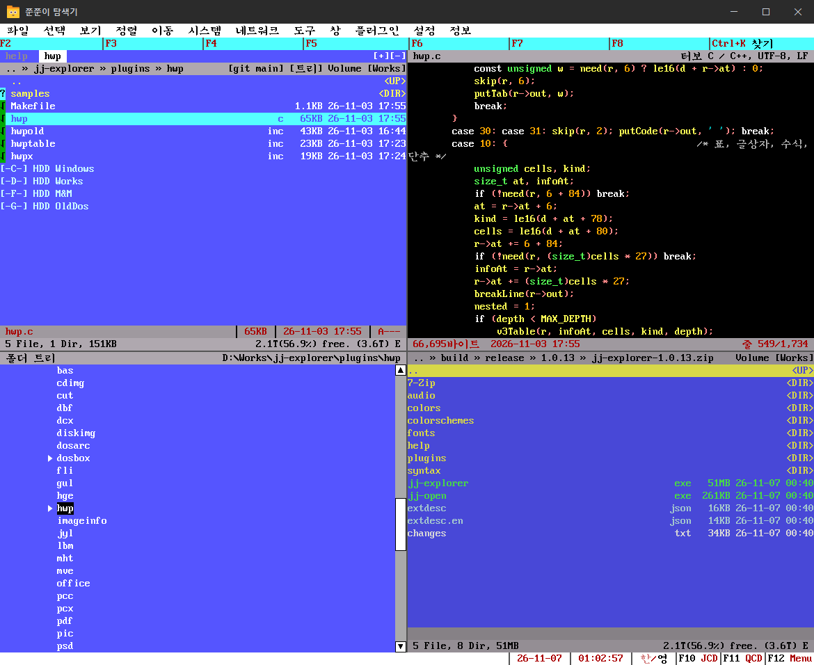
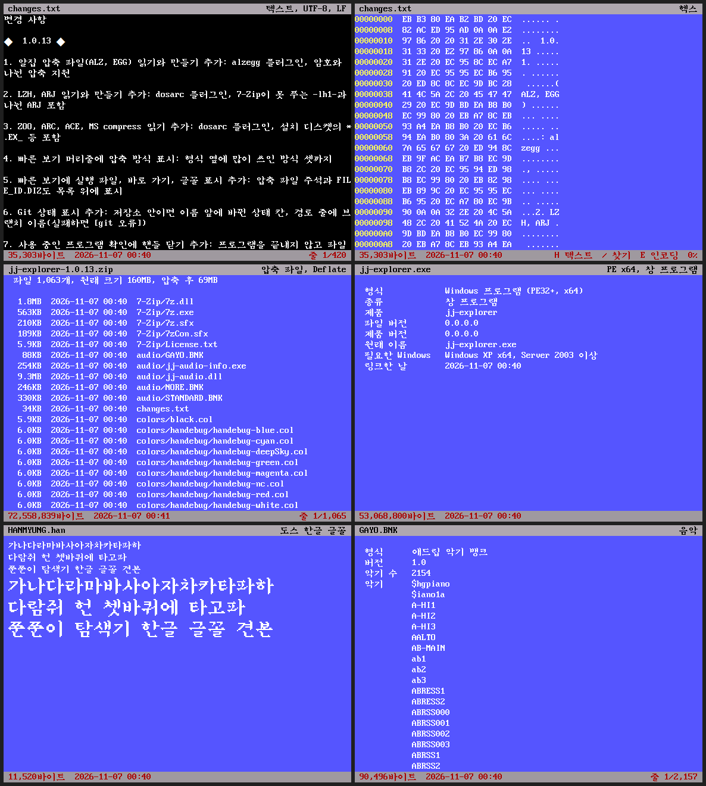
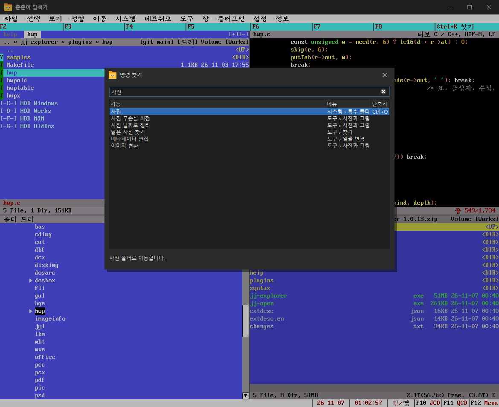
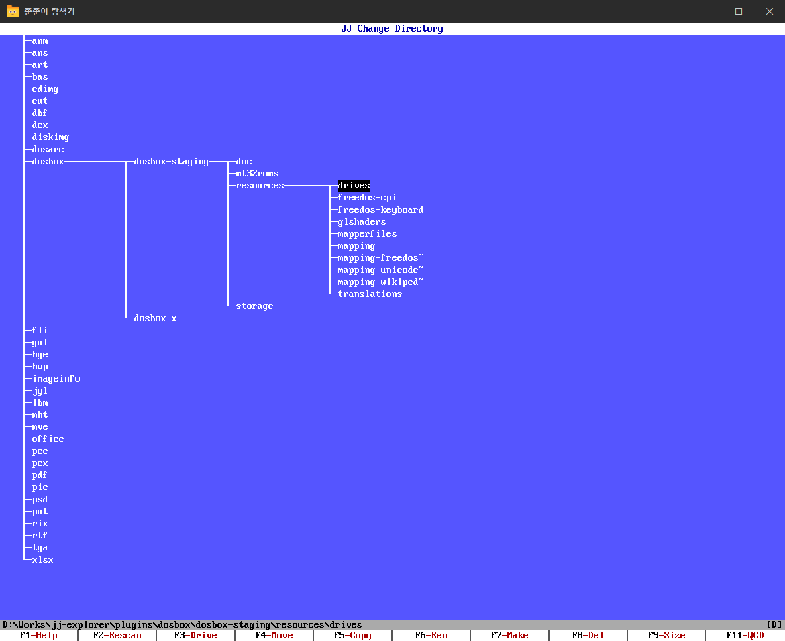
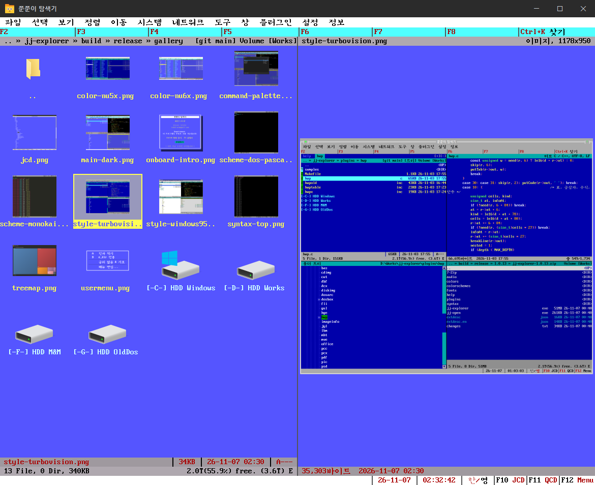
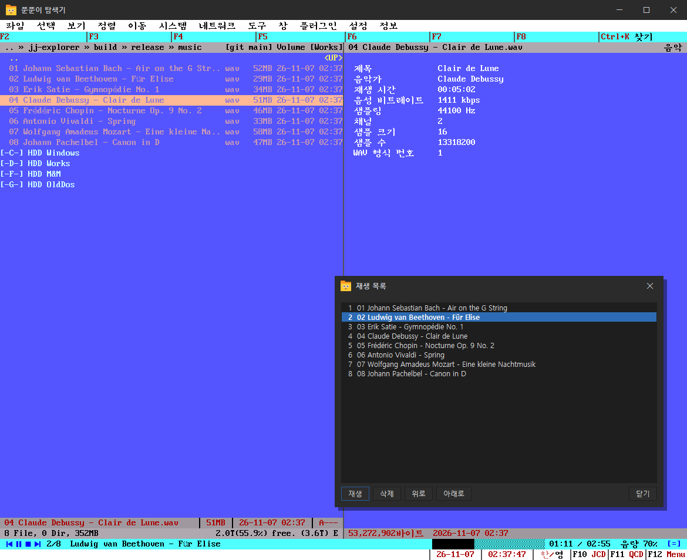
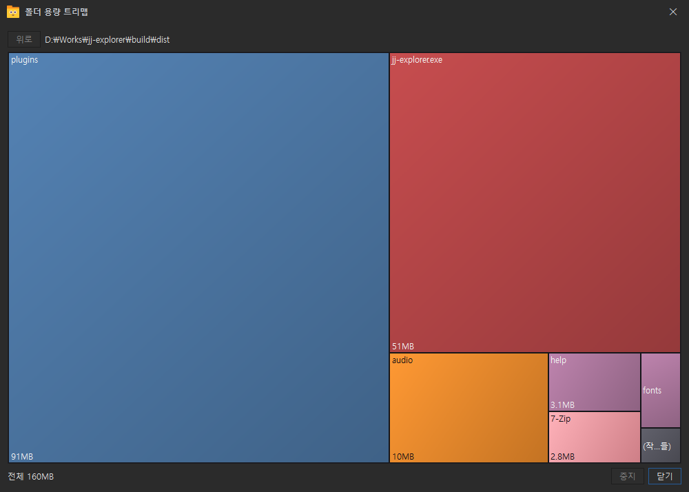
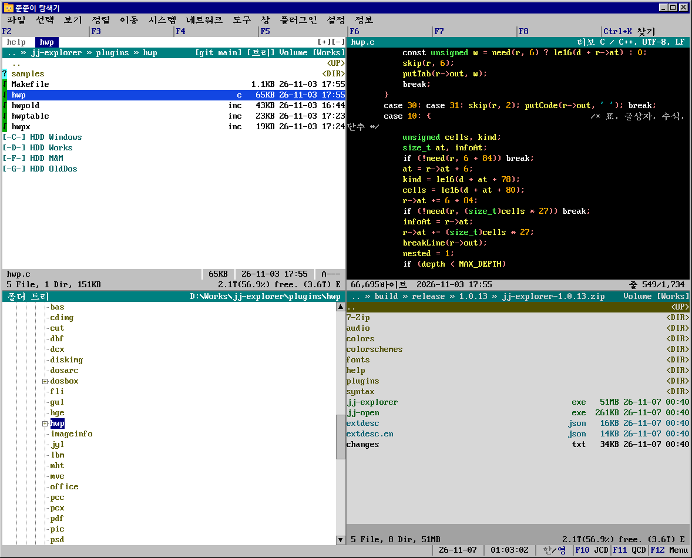
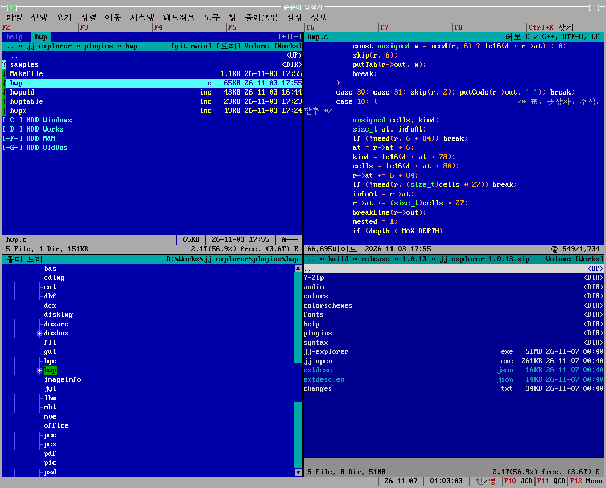

# JJ-Explorer (쭌쭌이 탐색기)

A file manager for Windows that brings back the look and feel of Mdir, the classic DOS file manager. Text-mode screen, bitmap Korean fonts and keyboard-first control, with the Windows features you expect: Recycle Bin, clipboard, shell context menus and long file names.

**[Download the latest version](https://github.com/hanulso78/jj-explorer-release/releases/latest)**

This repository only hosts the release files. Each release contains a zip file with the program and its manual.

The program and its manual are available in Korean and English. Choose the language in **Settings → Program Settings → Others → Language**; it switches at once without restarting.

## Features

**Panels and navigation**

- DOS text-mode screen with bitmap Korean and English fonts, or a Windows font of your choice, with adjustable zoom
- Keyboard-first control: arrow keys to move, Space to select, function keys for commands. The mouse works too
- Up to nine panels in 13 split layouts, panel tabs, window tabs that hold a whole layout, and saved workspaces
- Folder tree (JCD) or a Norton NCD style folder manager, a tree panel (Ctrl+T), favorite folders (QCD) with Shift+F1 to F12 hot keys, and back/forward history for each panel
- Quick View (Ctrl+W) shows text, hex, pictures, folders, archives and documents in the next panel, with syntax highlighting for about 45 languages
- Thumbnail view for pictures and videos
- Command palette (Ctrl+K) to find any command by name or Korean initial sounds
- Filters, seven sort orders with optional natural sort, groups, and a flat view of all files in subfolders
- FTP, SFTP, WebDAV and S3 folders open in a panel like local folders
- Recycle Bin panel (Ctrl+B) to see deletion dates and original locations and restore items
- Git status column and branch name inside repositories

**File operations**

- Copy, move, rename, delete to the Recycle Bin, with undo and redo
- Copy queue with pause, resume and retry, and an option to keep overwritten files in the Recycle Bin
- Folder synchronization (update, mirror or both ways)
- Bulk rename with find and replace, regular expressions, numbering, photo dates and clean-up rules, with a preview before renaming
- Color labels, ratings and tags for files, and a log of past operations
- Three sets of function keys (F2 to F9, plus Alt and Ctrl) and a user menu (Ctrl+Shift+M) for your own programs or built-in commands
- Run a program by file extension, and a command line with name completion and history

**Archives and disk images**

- Open zip, 7z and other archives like folders. Add, delete and rename files inside 7z, zip, tar and wim archives without extracting
- Create archives with split volumes, passwords and self-extracting files
- ALZ and EGG (ALZip), LZH and ARJ: read and create. ZOO, ARC, ACE and MS compress: read
- Floppy and hard disk images (IMG, IMA, TD0, IMD, D88, VHD and many more): browse, edit, create, check, defragment and make boot disks
- CD images (BIN/CUE, CCD/IMG, MDS/MDF, NRG): browse, audio tracks as WAV, convert to ISO, verify

**Tools**

- File search by name, content, size, date and attributes, including inside archives, with a fast mode that reads the NTFS file table
- Find duplicate files, similar photos, large files and empty folders
- Folder and file comparison
- Text encoding and line ending conversion, find and replace across many files
- Metadata editing for music, photos and MKV videos
- Image conversion, lossless JPEG rotation and photo organizing by date
- Folder size treemap, checksums (CRC32, MD5, SHA-1, SHA-256), file split and join, and a check for programs that lock a file, with handle closing
- Disk cleanup, startup programs, installed programs and process list
- Music player for MP3, FLAC, Ogg, MIDI, tracker modules (MOD, S3M, XM, IT) and AdLib formats
- Viewers for old formats through plugins: DOS pictures (PCX and more), Hangul documents (HWP), DOCX, PPTX, ODT, EPUB, PDF and more
- Run DOS programs and games with DOSBox Staging or DOSBox-X
- Screen savers

**Look**

- 13 dialog styles: Windows 3.1, 95, 98 and 2000, OS/2 Warp, Mac OS 8, Motif, NeXTSTEP, BeOS, Turbo Vision, GeoWorks Ensemble, light and dark
- Color files, including Norton Utilities, classic Korean DOS tools and Sublime Text color schemes

## Screenshots

**Quick View (Ctrl+W).** Shows the file under the cursor in the next panel without opening another program. From top left: a text file, the same file in hex (H), a zip file with its compression method, a Windows program, a DOS Hangul bitmap font, and an AdLib instrument bank.

**Command palette (Ctrl+K).** Type part of a name, or Korean initial sounds, to find any command with its menu and shortcut key.

**Folder manager (F10).** A Norton NCD style folder tree covers the window, with each level in its own column. Move with the arrow keys and press Enter to go to a folder, or make, rename and delete folders right there. The classic JCD list layout is also available.

**Thumbnail view (Alt+7).** Pictures and videos as a grid of thumbnails in a panel, here next to Quick View showing the picture under the cursor.

**Music player.** Play music from a panel without leaving it. The play bar at the bottom shows the track, time and volume, and the playlist (Ctrl+Alt+Y) lets you jump, remove and reorder tracks. Quick View shows the tags and format of the file under the cursor.

**Folder size treemap.** Each rectangle is sized by the space a file or folder takes. Click a folder to go inside.

**Dialog styles and color files.** The same screen in the Windows 95 style with the windows95 color file, and in the Turbo Vision style with the turbovision color file. Quick View follows the panel colors, like the Turbo C editor.

## Requirements

- Windows 10 (version 1809 or later) or Windows 11, 64-bit

## Install

1. Download `jj-explorer-<version>.zip` from the latest release.
2. Unzip it to any folder you can write to, for example `Documents\JJ-Explorer`. Avoid `Program Files`, because the program saves its settings in its own folder.
3. Run `jj-explorer.exe`. No installation is needed.

Press F1 in the program to open the manual.

## Update

Open **정보 (Info) → 업데이트 확인 (Check for updates)**. If a new version is available, click **지금 업데이트 (Update now)**. The program downloads it, checks its signature and restarts. Your settings, color files, syntax files, color schemes and plugin settings are kept.

You can also download the new zip and unzip it over the old folder.

## Uninstall

Close the program and delete its folder. All settings are stored in that folder (`jj-explorer.json`). If you saved FTP passwords, they are in Windows Credential Manager under names starting with `jj-explorer:`; delete them there if you want to remove them.

## Privacy

JJ-Explorer does not collect or send any usage data. It connects to the internet only when you click Check for updates (and then only to this GitHub repository), or when you connect to an FTP, SFTP, WebDAV or S3 server yourself.

## License

JJ-Explorer uses Qt (LGPL), 7-Zip (LGPL), libcurl, TagLib (MPL), libjpeg-turbo (BSD, IJG), DOSBox Staging and DOSBox-X (GPL), and the DOSMyungjo font (MIT). The music player uses AdPlug, Nuked OPL3, mpg123 and libsndfile (LGPL), and libopenmpt, FLAC, Ogg Vorbis, Opus and Monkey's Audio (BSD). This software is based in part on the work of the Independent JPEG Group.

본 제품은 한글과컴퓨터의 한/글 문서 파일(.hwp) 공개 문서를 참고하여 개발하였습니다.

## Support

JJ-Explorer is free to use. If it is useful to you, you can support its development:

- **GitHub Sponsors** (card, monthly or one time): https://github.com/sponsors/hanulso78
- **Bank transfer in Korea**: KakaoBank `3333346492333` (민인학)

## Contact

Questions and feedback: https://groups.google.com/g/jj-explorer2
